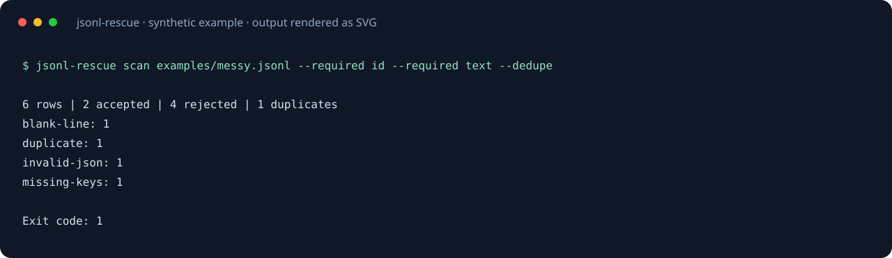

# JSONL Rescue

Clean your dataset. Keep every rejected row recoverable.

[](https://github.com/Yang1107-wzy/jsonl-rescue/actions/workflows/ci.yml)

[](LICENSE)

[中文说明](README.zh-CN.md) · [Releases](https://github.com/Yang1107-wzy/jsonl-rescue/releases) · [Contributing](CONTRIBUTING.md)



A streaming JSONL object validator and cleaner with optional disk-backed deduplication. Scan data before a training or evaluation run; split valid objects and rejected bytes into separate files without modifying the source. Supports plain JSONL and gzip input.

## Install

Python 3.10+; no runtime dependencies. The project is distributed on GitHub, not PyPI.

```sh
python -m pip install "git+https://github.com/Yang1107-wzy/jsonl-rescue.git@v1.0.0"
jsonl-rescue --version
```

Alternatively download the wheel from [Releases](https://github.com/Yang1107-wzy/jsonl-rescue/releases) and run `python -m pip install path/to/downloaded.whl` with its actual filename.

To run the bundled examples:

```sh
git clone https://github.com/Yang1107-wzy/jsonl-rescue.git
cd jsonl-rescue
python -m pip install .
```

## Try it

```sh
jsonl-rescue scan examples/messy.jsonl --required id --required text --dedupe
jsonl-rescue clean examples/messy.jsonl --required id --required text --dedupe --output clean.jsonl --rejects rejected.jsonl
```

The example contains 6 lines: 2 accepted, 4 rejected, including 1 duplicate. Scan exits 1; completed cleaning exits 0. Output paths must not already exist; choose new filenames when rerunning.

## What gets checked

- UTF-8 decoding and JSON syntax, including blank lines and a leading BOM.
- Object records: arrays and scalars are rejected by this dataset contract.
- Duplicate JSON property names and nonfinite numbers, without converting decimal numbers to binary floats. Decimal values such as `1e-400` remain exact in cleanup and deduplication; malformed or unsupported numeric literals are rejected.
- Presence of repeatable `--required KEY` top-level keys; this does not validate their values or types.
- With `--dedupe`: SHA-256 fingerprints of sorted-key, compact JSON with exact decimal serialization stored in temporary SQLite.

Deduplication is opt-in. It ignores object key order and whitespace, preserves list order, and is **not** semantic or approximate matching: `1` and `1.0` serialize differently, while decimal exponent formatting may normalize. Hash collisions are theoretically possible. Duplicate references point to the first **accepted** line. Missing or invalid records are never used as deduplication winners.

## Rejection archive

```json
{"line": 3, "code": "invalid-json", "raw_base64": "e2Jyb2tlbiBqc29ufQo="}
```

Decode `raw_base64` to recover the original rejected bytes, including line endings and invalid UTF-8. Duplicate records also have `first_line`. The cleaned file normalizes accepted objects to compact sorted-key JSON; use the unchanged original when you need original formatting or record ordering together with rejects. Rejection archives contain original data, so handle them with the same privacy care as the source.

```python
import base64
import json

with open("rejected.jsonl", encoding="utf-8") as archive:
    for text in archive:
        row = json.loads(text)
        raw = base64.b64decode(row["raw_base64"])
        # raw is the exact rejected line, as bytes
```

## Machine-readable reports

```sh
jsonl-rescue scan examples/messy.jsonl --dedupe --format json --max-issues 20
```

Reports include `schema_version`, `total`, `accepted`, `rejected`, `duplicates`, `issue_counts` and a bounded `issues` sample. `--max-issues` caps only report details; all rows still count and every rejected row is archived during cleaning. Reports omit record contents.

| Exit | Meaning |
| --- | --- |
| 0 | Scan has no rejected rows, or cleanup completed |
| 1 | Scan found rejected rows |
| 2 | Invalid usage or processing failure |

The accounting invariant is `total = accepted + rejected`; duplicates are a subset of rejected rows.

## File protection and resource usage

Inputs, clean output and rejection archive must be distinct paths. Existing output files and symlinks are refused; files are created exclusively. On ordinary processing exceptions, newly created outputs are removed. A process kill or machine crash can leave partial files: choose new filenames and inspect the source when restarting.

Memory scales with one input record plus a bounded report sample and SQLite cache; very large individual records still require memory. Deduplication uses temporary disk space proportional to unique records. gzip output, stdin, schema coercion and automatic syntax repair are outside v1.0. A valid empty file reports zero rows.

Based on the [JSON Lines format](https://jsonlines.org/), with a deliberately stricter object-only dataset contract. This is structural validation; it does not certify a provider-specific fine-tuning schema or data quality.

## Development

```sh
python -m pip install -e .
python -m unittest discover -s tests -v
```

CI runs on Linux, Windows and macOS. All examples are synthetic. [MIT license](LICENSE).
